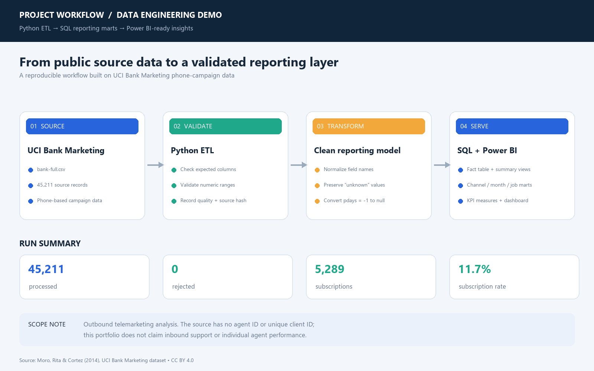
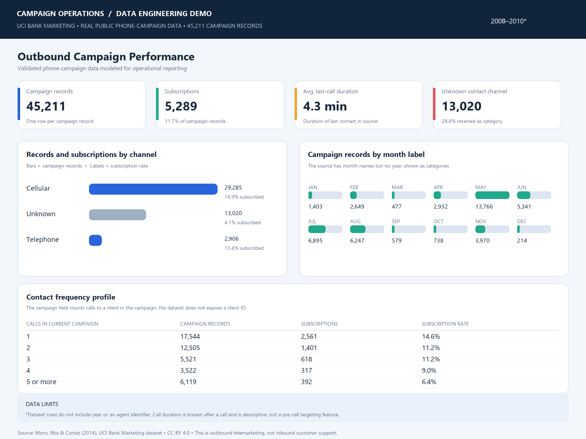

# Outbound Campaign Data Pipeline

An independent portfolio project that turns the UCI Bank Marketing dataset into a validated reporting layer for SQL and Power BI. This is public research data about **outbound phone marketing**, not inbound support-center data or client work.

## What this project demonstrates

- A reproducible Python ETL pipeline with schema and domain validation.
- A clean campaign fact file plus aggregate marts by channel, job category, and month label.
- A SQL Server reporting model with summary views.
- Power BI KPI measures and a dashboard concept built from the processed data.
- Data-quality reporting, source fingerprinting, and clear documentation of dataset limitations.

## Workflow





## Run results

| Measure | Result |
|---|---:|
| Source campaign records | 45,211 |
| Processed records | 45,211 |
| Rejected records | 0 |
| Duplicate rows observed | 0 |
| Term-deposit subscriptions | 5,289 |
| Subscription rate | 11.70% |
| Average last-call duration | 258.16 seconds |

`unknown` categories are preserved as source values. The source's `pdays = -1` sentinel is represented as a nullable prior-contact interval, alongside a flag indicating whether a previous contact occurred.

## Technology

Python (standard library ETL), CSV, SQL Server (DDL and reporting views), Power BI (measures and dashboard design).

## Repository contents

- `src/build_pipeline.py` — builds the cleaned fact, three aggregate marts, and quality report.
- `src/render_dashboard.py` — renders the dashboard preview from processed project data (requires Pillow).
- `src/render_workflow.py` — renders the workflow diagram (requires Pillow).
- `data/raw/README.md` — where to get the licensed source CSV and how to place it for a rebuild. The full raw CSV is kept out of this repository.
- `data/processed/` — compact aggregate marts and the actual-run quality report. The full row-level fact file is kept in the local project package rather than this public repo.
- `sql/campaign_reporting_mart.sql` — SQL Server fact-table DDL and reporting views.
- `power_bi_measures.dax.txt` — suggested DAX measures for the report.
- `campaign_data_workflow.png` and `call_campaign_dashboard_preview.png` — portfolio visuals.

## Rebuild the ETL outputs

Download `bank-full.csv` from the UCI dataset page linked below, then place it at `data/raw/bank-full.csv`. From this directory, run:

```powershell
python src/build_pipeline.py
```

The pipeline uses `data/raw/bank-full.csv` by default. It stops if the source schema, record count, or supported numeric domains do not match expectations; it does not silently discard invalid rows.

## Important data limitations

- The dataset has no agent identifier or unique client ID. It cannot support agent-level performance or reliable cross-row client reconciliation.
- `bank-full.csv` has month labels but no year or timestamp column. Month is treated as a category, not a time trend.
- `duration` describes the last call and is known only after that call. It is used descriptively, not as a pre-call targeting feature.
- This is an observational marketing dataset; the project reports descriptive patterns and does not claim causal effects.

## Source and attribution

Moro, S., Rita, P., & Cortez, P. (2014). *Bank Marketing* [Dataset]. UCI Machine Learning Repository. https://doi.org/10.24432/C5K306. [Dataset page](https://archive.ics.uci.edu/dataset/222/bank). Licensed under [Creative Commons Attribution 4.0 International (CC BY 4.0)](https://creativecommons.org/licenses/by/4.0/). The dataset describes direct marketing campaigns by phone for a Portuguese banking institution.

## Copy-ready Upwork portfolio summary

I built a reproducible Python ETL workflow that turns public bank phone-campaign data into a validated reporting layer for SQL and Power BI. It processes 45,211 records, validates the source schema and numeric fields, preserves meaningful `unknown` categories, and creates a clean fact file, SQL reporting views, summary marts, Power BI measures, and a dashboard preview. The run processed all 45,211 records with none rejected. This is an independent portfolio project using the UCI Bank Marketing dataset; it is outbound campaign analysis, not inbound support-center or agent-performance reporting.

